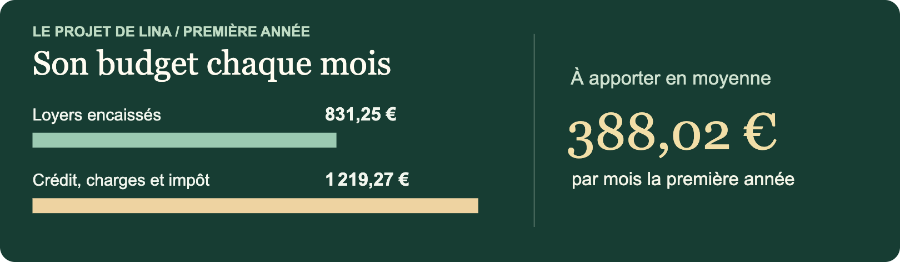

# Ma Rentabilité IA

**Le loyer couvrira-t-il le crédit, les charges et l’impôt ?** Donnez le lien de ce dépôt à votre IA et parlez-lui du bien que vous envisagez. Elle vous aide à retrouver les chiffres manquants, compare vos options et vous rend un bilan que vous pouvez vérifier.

[Voir un bilan en PDF](exemples/bilan-lina.pdf) · [Comprendre tous les calculs](CALCULS.md) · [Consulter les fiches vérifiées](articles/README.md)

## Commencer avec mon IA

Copiez ce message dans ChatGPT, Claude, Codex ou votre assistant habituel. Vous pouvez déjà y ajouter le prix, le loyer ou votre première question.

```text
Lis https://github.com/fmacfa/ma-rentabilite-ia et accompagne-moi pour étudier mon projet locatif.
Pose-moi les questions au fur et à mesure. À la fin, montre les calculs avec mes chiffres et donne-moi le bilan en PDF.
```

1. **Dites ce que vous voulez décider.** Par exemple, « Puis-je financer ce logement avec 250 € par mois de ma poche ? » L’IA part de ce que vous connaissez et vous aide à trouver le reste dans l’annonce, le devis ou l’offre de prêt.
2. **Essayez une autre hypothèse.** Que se passe-t-il avec un loyer plus bas, deux mois de travaux ou un autre régime fiscal ? Demandez l’écart en euros et la source de la règle appliquée.
3. **Gardez le détail.** Vous recevez dans la conversation les hypothèses, les opérations et les résultats année par année. Votre IA peut joindre le PDF ou vous donner un lien personnel pour le télécharger.

C’est votre première conversation sur le projet ? Le guide d’accompagnement se lit directement sur GitHub. Si votre assistant ne peut pas ouvrir le dépôt, collez le texte de ce guide dans le chat. [Lire le guide](assistant.md) · [Copier sa version texte](https://raw.githubusercontent.com/fmacfa/ma-rentabilite-ia/main/assistant.md)

## Exemple · Le projet de Lina

> **Lina** — J’ai trouvé un appartement à 140 000 €. Je pense le louer meublé 1 050 € par mois. Combien dois-je prévoir de ma poche ?
>
> **L’IA** — Commençons par le crédit et le premier loyer. Quelle mensualité, assurance comprise, figure sur votre offre ? Combien de mois de travaux prévoyez-vous avant de louer ?
>
> **Lina** — Environ 871 € par mois de crédit et deux mois de travaux. Ensuite, je voudrais tester 5 % de vacance.



Avec **2 980 € de charges annuelles** et une **hypothèse de 1 200 € d’impôt**, Lina doit apporter **388,02 € par mois en moyenne la première année**, en plus des **28 300 €** engagés à l’achat. Si le loyer baisse de 10 %, l’effort passe à **471,15 € par mois**.

<details>
<summary>Refaire le calcul de Lina en quatre lignes</summary>

| Première année | Opération | Résultat |
| --- | --- | ---: |
| Loyers encaissés | 1 050 € × 10 mois ouverts × 95 % | 9 975,00 € |
| Revenu après charges | 9 975 € − 2 980 € | 6 995,00 € |
| Trésorerie après crédit et impôt | 6 995 € − 10 451,30 € − 1 200 € | −4 656,30 € |
| Effort d’épargne mensuel moyen | 4 656,30 € / 12 | **388,02 €** |

Les montants sont arrondis à l’affichage. L’effort annuel avant arrondi est de 4 656,2991 €, soit 388,0249 € par mois. Le bilan donne les 240 échéances du prêt et suit le projet jusqu’à la revente en année 10.

</details>

**[Lire le bilan détaillé de Lina](exemples/lina.md)** · **[Ouvrir son PDF](exemples/bilan-lina.pdf)**

## Explorer une situation proche de la mienne

| Votre question | Exemple chiffré |
| --- | --- |
| Quel impôt avec le micro-foncier ou le réel ? | [Location nue](exemples/location-nue.md) |
| Que changent les amortissements de mon meublé ? | [Meublé de longue durée](exemples/location-meublee.md) |
| Combien rapporte un logement loué à la nuit ? | [Meublé de tourisme](exemples/tourisme.md) |
| Quelle somme arrive réellement chez l’associé ? | [SCI à l’IS et dividendes](exemples/sci-is.md) |
| Quel effet aurait la déduction Jeanbrun sur mes revenus ? | [Location nue sous Jeanbrun](exemples/jeanbrun.md) |

## Retrouver une formule ou une source

Les **formules** expliquent comment passer des loyers à la trésorerie, puis de la revente au rendement sur dix ans. Les **fiches vérifiées** indiquent quel chiffre utiliser et dans quelles conditions. Les règles fiscales du projet portent sur les revenus **2026**. Chaque fiche précise sa date de vérification et renvoie aux sources qui permettent de la contrôler. [Tous les calculs](CALCULS.md) · [Fiches et sources](articles/README.md) · [Guide pratique de ma-rentabilite.fr](guide/README.md)

Vos chiffres se partagent dans votre conversation privée. Si vous transmettez le lien de votre bilan, son destinataire pourra en lire les montants.
